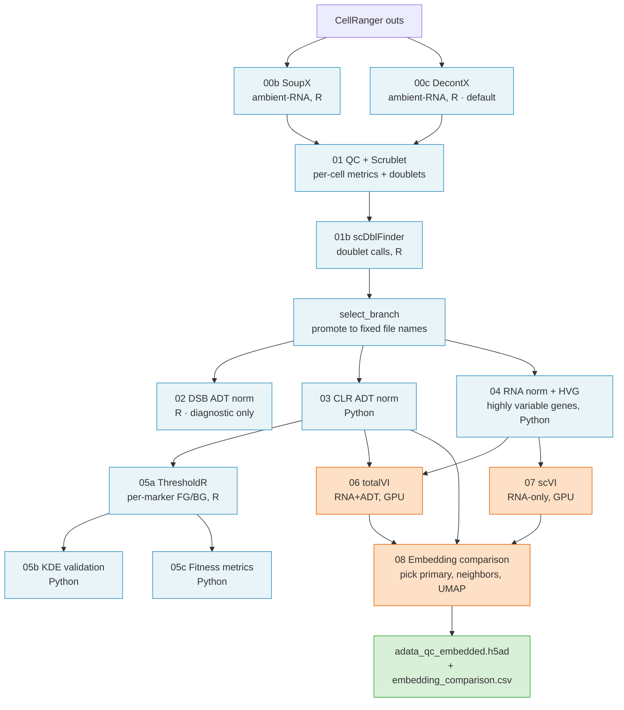

# citeseq-nf: Generic CITE-seq Preprocessing + Embedding Pipeline

A Nextflow pipeline for the generic part of a CITE-seq analysis: ambient-RNA
decontamination, per-cell QC, ADT and RNA normalization, marker-threshold
gating, and joint totalVI + scVI integration with a primary-embedding choice.

It produces one file, `adata_qc_embedded.h5ad`. Study-specific analysis reads
that file and continues from there.

## Pipeline DAG

The pipeline fans out per library through gating, then joins the libraries
for embedding. Phase A (QC + normalization + gating) runs once per library.
Phase B (totalVI + scVI + embedding comparison) runs once on the cohort.



The CLR output (step 03) is used more widely than most of the arrows suggest.
The diagram draws its three main consumers: step 05a, step 06 and step 08.
Step 08 reads it as one of three inputs, next to the totalVI and scVI files:
see `modules/step08_embedding.nf`. Steps 05b and 05c read it too, and step 05c
also reads the RNA-normalized file from step 04. Those last three arrows are
left out to keep the picture readable.


## Outputs

Written under `--outdir`:

| Path | Contents |
|---|---|
| `data/processed/adata_qc_embedded.h5ad` | The terminal artifact. `X_umap`, `X_totalVI`/`X_scVI`, `uns['primary_embedding']`, neighbor graph, HVG and CLR ADT layers. |
| `results/phase2_embedding/embedding_comparison.csv` | Which embedding was chosen: `batch_silhouette`, `bio_silhouette_<MARKER>`, `decision`. |
| `results/`, `figures/`, `models/` | QC summaries, plots, trained totalVI and scVI models. |

## Requirements

- Nextflow 25.10.4 (DSL 2)
- A conda environment built from [env/environment.yml](env/environment.yml)
- A GPU for steps 06 (totalVI) and 07 (scVI)
- SGE, or edit `conf/sge.config` for another scheduler

## Installation

```bash
git clone <repo-url>/citeseq-nf.git && cd citeseq-nf
mamba env create -f env/environment.yml
mamba activate citeseq-nf
Rscript env/r_extra.R
```

Full build steps and package list: [env/README.md](env/README.md).

## Quick start

```bash
module load nextflow/25.10.4
export CITESEQ_NF=/path/to/citeseq-nf

${CITESEQ_NF}/run.sh run \
    ${CITESEQ_NF}/main.nf \
    -profile sge \
    --project_root /path/to/your/study \
    --outdir       /path/to/your/study \
    --conda_env    /path/to/envs/citeseq-nf \
    --panel        /path/to/your_panel.yaml \
    --data_root    /path/to/your/cellranger_outs \
    --sample_metadata_json /path/to/sample_metadata.json \
    --sge_gpu_totalvi_queue 'gpu.q@<your-gpu-host>' \
    --sge_gpu_scvi_queue    'gpu.q@<your-gpu-host>'
```

Add `-resume` to reuse cached steps. Use `-profile local` to run without a
scheduler.

## Inputs

| Input | Set with | Notes |
|---|---|---|
| CellRanger data root | `--data_root` | One subdirectory per library, each holding `raw_feature_bc_matrix.h5`, `filtered_feature_bc_matrix.h5` and the graph-based clusters. |
| `sample_metadata.json` | `--sample_metadata_json` | `library_id` to `{donor, age, age_group, timepoint, replicate}`. Its key count sets how many libraries to process. |
| `forced_hvgs.txt` | `--forced_hvgs_file` | One gene symbol per line. These always enter the HVG set. |

### Two supported data layouts

Steps 00b and 00c need the CellRanger graph-based clusters. Both layouts
below work, and you do not have to tell the pipeline which one you have. It
looks for the first one that exists, per library.

| Layout | Where the clusters live |
|---|---|
| Local `cellranger count` tree | `<data_root>/<library_id>/[outs/]analysis/clustering/{gene_expression_graphclust,graphclust}/clusters.csv` |
| 10x Cloud Analysis download | `<data_root>/<library_id>/analysis.tar.gz`, member `clustering/{gene_expression_graphclust,graphclust}/clusters.csv` |

The two `.h5` matrix files sit at `<data_root>/<library_id>/` in both cases.
If neither layout is found, the step stops and prints every path it searched.


<details><summary>Example sample_metadata.json + forced_hvgs.txt</summary>

```json
{
  "Lib01": {"donor": "Donor_A", "age": 25, "age_group": "young", "timepoint": "d0", "replicate": 1},
  "Lib02": {"donor": "Donor_B", "age": 68, "age_group": "aged",  "timepoint": "d7", "replicate": 1}
}
```

```
# Cytotoxicity markers
GNLY
NKG7
PRF1

# Transcription factors
GATA3
TBX21
```

</details>


## Entry points

Skip earlier steps by entering at a checkpoint with pre-computed inputs.

| Entry | What it runs | Required inputs (beyond the always-required params) |
|---|---|---|
| `(default)` / `from_cellranger` | Full pipeline: Phase A QC → Phase B embed | `--sample_metadata_json` or `--n_libraries`. Phase A stops with an error when you pass neither. |
| `from_qc` | Normalization + gating + embed | `--adata_qc`, `--adata_adt_raw`, `--adt_counts_for_thresholdr` |
| `from_clr` | Stage CLR file (no-op validation) | `--adata_qc_clr` |
| `clr_only` | Step 03 CLR only (POC) | `--adata_qc`, `--adata_adt_raw` |
| `from_hvg` | totalVI + scVI + embedding comparison | Defaults to `{project_root}/data/processed/adata_qc_hvg.h5ad` + `{project_root}/data/processed/adata_qc_clr.h5ad`; override with `--adata_qc_hvg` / `--adata_qc_clr` |
| `from_totalvi_scvi` | Step 08 only, against existing totalVI + scVI outputs | Defaults to `{project_root}/data/processed/adata_totalvi.h5ad` + `adata_scvi.h5ad` + `adata_qc_clr.h5ad`; override with `--adata_totalvi` / `--adata_scvi` / `--adata_qc_clr` |

The two default paths above are built from `--project_root`, not from
`--outdir`. When the two params differ, pass the checkpoint files by hand.

```bash
# Reuse existing embeddings, rerun only step 08
${CITESEQ_NF}/run.sh run \
    ${CITESEQ_NF}/main.nf \
    -profile sge -entry from_totalvi_scvi \
    --project_root /path/to/study --outdir /path/to/study \
    --conda_env /path/to/envs/citeseq-nf \
    --panel /path/to/your_panel.yaml \
    --data_root /path/to/cellranger_outs
```


## Parameters

Scientific defaults (QC thresholds, normalization settings) live in
`scripts/config.py` and `scripts/config.R`. Nextflow exports an environment
variable only when you pass the matching param, so omitting a param keeps the
config default active.

### Required

| Param | Meaning |
|---|---|
| `--project_root` | Study root. Anchors output locations. |
| `--outdir` | Where outputs are written. Usually equal to `--project_root`. |
| `--conda_env` | Path to the conda environment. `--python` and `--rscript` derive from it. |
| `--panel` | ADT panel YAML. See `panels/example_panel.yaml`. |
| `--data_root` | CellRanger input root. |
| `--sge_gpu_totalvi_queue` | GPU queue for step 06, under `-profile sge`. |
| `--sge_gpu_scvi_queue` | GPU queue for step 07, under `-profile sge`. |

### Optional

| Param | Default | Meaning |
|---|---|---|
| `--sample_metadata_json` | none | Library metadata. Its key count sets the library number. |
| `--n_libraries` | from metadata | Run on the first N libraries only. Every step honours it. |
| `--forced_hvgs_file` | none | Genes always kept as highly variable. |
| `--biological_separation_marker` | none | ADT marker used as the biological axis in the step 08 silhouette score. |
| `--branch` | `decontx` | Decontamination branch: `decontx` or `soupx`. |
| `--run_both_branches` | `false` | Run SoupX and DecontX both, for comparison. |
| `--qc_mad_n_mads` | config default | QC MAD threshold. |
| `--python`, `--rscript` | from `--conda_env` | Override the interpreters. |

Checkpoint inputs for the entry points: `--adata_qc`, `--adata_adt_raw`,
`--adt_counts_for_thresholdr`, `--adata_qc_clr`, `--adata_qc_hvg`,
`--adata_totalvi`, `--adata_scvi`.

## Configuration

| Profile | Executor | Use |
|---|---|---|
| `local` | local machine | interactive testing |
| `sge` | SGE cluster | production runs |

Resource labels, set in `conf/resources.config`:

| Label | CPUs | Memory | Time |
|---|---|---|---|
| `cpu_small` | 2 | 8 GB | 1h |
| `cpu_medium` | 4 | 16 GB | 2h |
| `cpu_large` | 8 | 32 GB | 4h |
| `gpu_totalvi` | 4 | 64 GB | 4h |
| `gpu_scvi` | 8 | 12 GB | 4h |

For another scheduler, edit `conf/sge.config` (executor, parallel environment,
GPU clusterOptions) and add a matching profile in `nextflow.config`.

## Antibody panel configuration

Copy `panels/example_panel.yaml`. Replace the placeholder marker names
(`MARKER_A`, `MARKER_B`, …) and the gene lists with your own panel. Pass the
file with `--panel /path/to/your_panel.yaml`.

`scripts/config.py` checks the YAML the moment it is imported. It checks
that all required keys are there and that the marker names agree with each
other. A bad panel file stops the script right away, before it reads any
data.

The panel file drives four things:

- the remap from CellRanger feature names to canonical names (the short
  marker names used everywhere downstream);
- the functional, ThresholdR and KDE marker subsets;
- the reference markers for BIC, a score used to choose how many mixture
  components to fit;
- the RNA-concordance map.

<details><summary>Schema reference (8 keys, 5 required / 3 optional)</summary>

| Key | Required? | Meaning |
|---|---|---|
| `cellranger_names` | yes | Feature names as they appear in `feature_bc_matrix.h5`. |
| `rename_map` | yes | CellRanger name → canonical short name used downstream. |
| `functional` | yes | Markers that passed reagent QC (subset of canonical names). |
| `thresholdr` | yes | Markers entering ThresholdR GMM gating. |
| `thresholdr_reference` | yes | Non-empty subset of `thresholdr`. It drives the BIC threshold. Pick markers known to be bimodal (two clear peaks). |
| `fgprob_override` | no | Markers forced to use totalVI fg_prob instead of ThresholdR (e.g., very rare populations). |
| `kde_validate` | no | Markers included in the KDE gating diagnostic. |
| `rna_concordance` | no | Per-marker RNA validators (`positive` / `negative` gene lists + `description`). Keys must be in `functional`. |

**Validation rules** enforced at load:

- Every marker in `functional`, `thresholdr`, `thresholdr_reference`,
  `fgprob_override` and `kde_validate` must appear as a value in
  `rename_map`.
- Every key of `rename_map` must appear in `cellranger_names`.
- `thresholdr_reference` must be a non-empty subset of `thresholdr`.
- Every key of `rna_concordance` must be in `functional`.

</details>


## Tests

`tests/` holds four SGE job scripts that check the pipeline on your cluster.
They take every path and queue name from environment variables. See
[tests/README.md](tests/README.md) for the variable contract and the
recommended order.

Reference numbers from the last full run are in
[docs/reference_run.md](docs/reference_run.md), with the small result tables in
[tests/baseline/](tests/baseline/).

## Troubleshooting

- **`Required param missing: ...`** Pass the named param. See Parameters.
- **`ThresholdR::get_thresholds()` fails.** Install the optional dependency
  with `Rscript -e 'install.packages("AdaptGauss")'`, or rerun
  `Rscript env/r_extra.R` with `THRESHOLDR_SOURCE=vendor`.
- **`CITESEQ_PYTHON_BIN env var not set`** from an R script. Nextflow sets it.
  When running an R step by hand, export it first.
- **GPU step queue errors under `-profile sge`.** Set
  `--sge_gpu_totalvi_queue` and `--sge_gpu_scvi_queue`.
- **`-resume` does not reuse steps.** Inputs or params changed. Changing
  `--qc_mad_n_mads` invalidates everything from step 01 on.
- **`.nextflow.log*` in the working tree.** Use `run.sh` instead of calling
  `nextflow` directly.

## Development

See [docs/development.md](docs/development.md) for design rules, how to add a
step, and the repository layout.

## License

