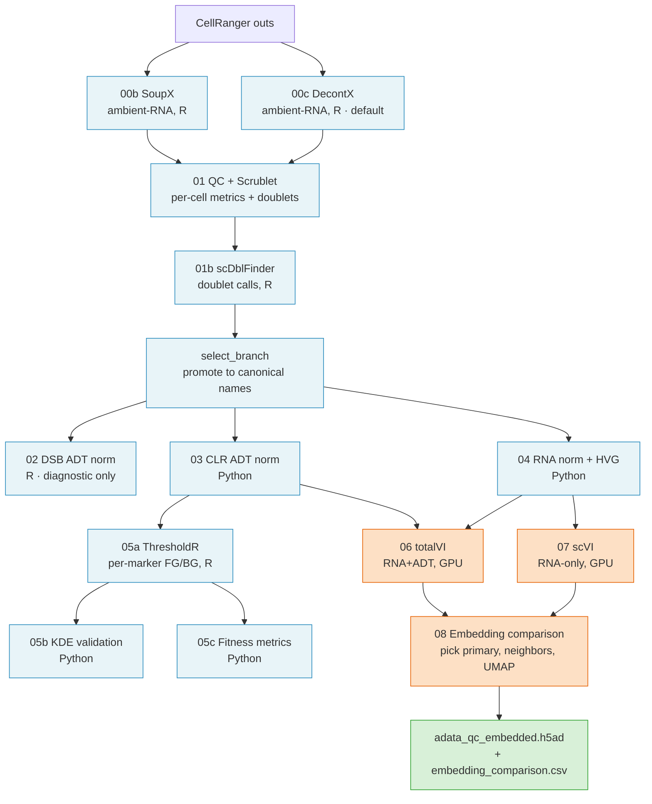

# citeseq-nf — Generic CITE-seq Preprocessing + Embedding Pipeline

A Nextflow pipeline for the method-driven, generic portion of a CITE-seq
analysis: ambient-RNA decontamination, per-cell QC, ADT/RNA normalization,
marker-threshold gating, and joint totalVI + scVI integration with a
primary-embedding selection step. It produces a canonical
`adata_qc_embedded.h5ad` artifact that downstream, study-specific analyses
consume.

## What the pipeline does

- Runs a fan-out branch per CellRanger library (decontamination → QC →
  normalization → gating).
- Integrates the full cohort with totalVI (joint RNA+ADT) and scVI (RNA-only)
  on GPU.
- Compares the two embeddings and produces a single UMAP + neighbor graph on
  the chosen primary embedding.

## Pipeline DAG

Per-library fan-out through gating, then aggregated for embedding. Phase A
(QC + normalization + gating) runs once per library; Phase B (totalVI +
scVI + embedding comparison) runs once on the cohort.



## Handoff contract

At step 08 the pipeline produces two terminal artifacts that calling studies
consume:

| Artifact | Relative path (under `--outdir`) | Role |
|---|---|---|
| `adata_qc_embedded.h5ad` | `data/processed/` | Canonical input for downstream classification / hypothesis testing. Contains `X_umap`, `X_totalVI`/`X_scVI`, `uns['primary_embedding']`, neighbor graph, HVG + CLR ADT layers. |
| `embedding_comparison.csv` | `results/phase2_embedding/` | Audit trail — which embedding was chosen and why (silhouette, cluster agreement, etc.). |

The filenames are the interface. Any downstream step that reads
`adata_qc_embedded.h5ad` from the configured processed-data directory is a
valid consumer — no code-level imports required.

## Downstream — bring your own

citeseq-nf ends at step 08. Cell-type classification, hypothesis testing,
panel-specific gating, and manuscript figures live in the calling study
repo, which reads `adata_qc_embedded.h5ad` from `{outdir}/data/processed/`
and proceeds with plain Python/R invocations.

## Prerequisites

- **Nextflow** ≥ 23.04 (DSL 2). Tested with 25.10.4.
- **Conda or mamba** environment containing:
  - Python: `scanpy`, `scvi-tools` (totalVI + scVI), `anndata`, `scrublet`,
    `rpy2`, `pyyaml`
  - R: `SoupX`, `celda` (DecontX), `scDblFinder`, `dsb`, `ThresholdR`
- **GPU access** for steps 06 (totalVI) and 07 (scVI).
- **An SGE cluster**, or fork `conf/sge.config` for your scheduler
  (Slurm / AWS Batch / etc.).

The conda environment is **not shipped** with this repo — build your own and
pass its path via `--conda_env`.

## Installation

```bash
git clone <repo-url>/citeseq-nf.git
export CITESEQ_NF=$(realpath citeseq-nf)
```

That's it. Nextflow resolves `main.nf` and modules from `${CITESEQ_NF}`; no
build step.

## Quick start

Set `CITESEQ_NF` to the cloned repo, then call `run.sh` with the four
required params (`--project_root`, `--outdir`, `--conda_env`, `--panel`)
and your SGE GPU queues.

```bash
module load nextflow/25.10.4
export CITESEQ_NF=/path/to/citeseq-nf

${CITESEQ_NF}/run.sh run \
    ${CITESEQ_NF}/main.nf \
    -profile sge \
    --project_root /path/to/your/study \
    --outdir       /path/to/your/study \
    --conda_env    /path/to/your/envs/cite_seq \
    --panel        /path/to/your/study/panels/your_panel.yaml \
    --sge_gpu_totalvi_queue 'gpu.q@<your-gpu-host>' \
    --sge_gpu_scvi_queue    'gpu.q@<your-gpu-host>' \
    --forced_hvgs_file     /path/to/your/study/panels/your_forced_hvgs.txt \
    --sample_metadata_json /path/to/your/study/panels/sample_metadata.json
```

The pipeline writes to:

- `{outdir}/data/processed/` — h5ad checkpoints (including the terminal
  `adata_qc_embedded.h5ad`)
- `{outdir}/results/` — CSVs, QC summaries, `embedding_comparison.csv`
- `{outdir}/models/` — trained totalVI + scVI models
- `{outdir}/figures/` — QC plots, UMAP overviews, threshold diagnostics
- `{outdir}/logs/nextflow/` — timeline, report, and `.nextflow.log*` (via
  `run.sh`)

Always use the `run.sh` wrapper — it redirects `.nextflow.log*` into
`logs/nextflow/` so they don't clutter the working tree.

```bash
# Local executor — useful for interactive testing on a small library
${CITESEQ_NF}/run.sh run \
    ${CITESEQ_NF}/main.nf \
    -profile local \
    --project_root /path/to/study --outdir /path/to/study \
    --conda_env /path/to/envs/cite_seq \
    --panel /path/to/your_panel.yaml

# Resume from cache (instant if inputs + params unchanged)
${CITESEQ_NF}/run.sh run \
    ${CITESEQ_NF}/main.nf \
    -profile sge -resume \
    --project_root /path/to/study --outdir /path/to/study \
    --conda_env /path/to/envs/cite_seq \
    --panel /path/to/your_panel.yaml
```

## Inputs

| Input | Required? | Default location | Notes |
|---|---|---|---|
| CellRanger `outs/` | yes | `{project_root}/10X_cloud/outs/<library_id>/` | Override with `--data_root`. Each `<library_id>` is a standard CellRanger output dir. |
| `sample_metadata.json` | optional | passed via `--sample_metadata_json` | JSON dict: `library_id` → `{donor, age, age_group, timepoint, replicate}`. Unknown keys ignored. |
| `forced_hvgs.txt` | optional | passed via `--forced_hvgs_file` | One gene symbol per line; `#` comments and blanks ignored. Genes are pinned into the HVG set regardless of Seurat-v3 ranking. |

<details><summary>Example sample_metadata.json + forced_hvgs.txt</summary>

```json
{
  "Lib01": {"donor": "Donor_A", "age": 25, "age_group": "young", "timepoint": "d0", "replicate": 1},
  "Lib02": {"donor": "Donor_B", "age": 68, "age_group": "aged",  "timepoint": "d7", "replicate": 1}
}
```

```
# Cytotoxicity markers
GNLY
NKG7
PRF1

# Transcription factors
GATA3
TBX21
```

</details>

## Entry points

Skip earlier steps by entering at a checkpoint with pre-computed inputs.

| Entry | What it runs | Required inputs (beyond the three required params) |
|---|---|---|
| `(default)` / `from_cellranger` | Full pipeline: Phase A QC → Phase B embed | none |
| `from_qc` | Normalization + gating + embed | `--adata_qc`, `--adata_adt_raw`, `--adt_counts_for_thresholdr` |
| `from_clr` | Stage CLR file (no-op validation) | `--adata_qc_clr` |
| `clr_only` | Step 03 CLR only (POC) | `--adata_qc`, `--adata_adt_raw` |
| `from_hvg` | totalVI + scVI + embedding comparison | Defaults to `data/processed/adata_qc_hvg.h5ad` + `data/processed/adata_qc_clr.h5ad`; override with `--adata_qc_hvg` / `--adata_qc_clr` |
| `from_totalvi_scvi` | Step 08 only, against existing totalVI + scVI outputs | Defaults to `data/processed/adata_totalvi.h5ad` + `adata_scvi.h5ad` + `adata_qc_clr.h5ad`; override with `--adata_totalvi` / `--adata_scvi` / `--adata_qc_clr` |

```bash
# Reuse existing embeddings, rerun only step 08
${CITESEQ_NF}/run.sh run \
    ${CITESEQ_NF}/main.nf \
    -profile sge -entry from_totalvi_scvi \
    --project_root /path/to/study --outdir /path/to/study \
    --conda_env /path/to/envs/cite_seq \
    --panel /path/to/your_panel.yaml
```

## Parameters

All Nextflow params default to `null` unless noted. Defaults for *scientific*
values (QC thresholds, normalization parameters, etc.) live in
`scripts/config.py` and `scripts/config.R`; the Nextflow layer only exports
environment variables when a param is explicitly passed, so config-side
defaults stay active when callers omit a param.

### Required

| Param | When required | Meaning |
|---|---|---|
| `--project_root` | always | Absolute path to the calling study's root. Anchors input lookup (via `--data_root` default) and output locations. |
| `--outdir` | always | Where to write all pipeline outputs. Usually equal to `--project_root`. |
| `--conda_env` | always | Absolute path to the CITE-seq conda/mamba environment. `--python` and `--rscript` default to `${conda_env}/bin/python` and `${conda_env}/bin/Rscript`. |
| `--panel` | always | Path to an ADT panel YAML. See `panels/example_panel.yaml` for the schema. |
| `--sge_gpu_totalvi_queue` | GPU steps under `-profile sge` | SGE queue spec for the totalVI GPU step, e.g. `gpu.q@<host>`. |
| `--sge_gpu_scvi_queue` | GPU steps under `-profile sge` | SGE queue spec for the scVI GPU step, e.g. `gpu.q@<host>`. |

### Optional overrides

| Param | Default | Meaning |
|---|---|---|
| `--python` | `${conda_env}/bin/python` | Override the Python interpreter used by Python step modules. |
| `--rscript` | `${conda_env}/bin/Rscript` | Override the Rscript interpreter used by R step modules. |
| `--forced_hvgs_file` | *(empty)* | Text file with one gene symbol per line. Blank lines and `#`-prefixed comments ignored. Empty = Seurat-v3 auto-selection only. |
| `--sample_metadata_json` | *(empty)* | JSON dict mapping `library_id` → metadata object (see Inputs). |
| `--data_root` | `{project_root}/10X_cloud/outs` | CellRanger `outs/` root. |
| `--branch` | *(auto)* | Decontamination branch to use downstream (`decontx` or `soupx`). |
| `--run_both_branches` | `false` | Run both SoupX and DecontX (for comparison); default runs only the selected branch. |
| `--qc_mad_n_mads` | *(config default)* | QC MAD threshold for per-cell metrics. Exported as `SAGE_QC_MAD_N_MADS`. |
| `--biological_separation_marker` | *(skipped)* | One ADT marker name used by step 08 as the biological-separation axis when scoring totalVI vs scVI silhouette. Cells split on `ADT_<marker>_fg_prob > 0.5`. Empty = step 08 emits `bio_silhouette_skipped` and falls back to batch-mixing alone. Exported as `SAGE_BIOLOGICAL_SEPARATION_MARKER`. |

### Checkpoint inputs (used by entry points)

| Param | Used by |
|---|---|
| `--adata_qc` | `from_qc` |
| `--adata_adt_raw` | `from_qc`, `clr_only` |
| `--adt_counts_for_thresholdr` | `from_qc` |
| `--adata_qc_clr` | `from_clr`, `from_hvg`, `from_totalvi_scvi` |
| `--adata_qc_hvg` | `from_hvg` |
| `--adata_totalvi` | `from_totalvi_scvi` |
| `--adata_scvi` | `from_totalvi_scvi` |

### Override mechanism

Overrides flow Nextflow → env var → `config.py`:

```bash
${CITESEQ_NF}/run.sh run \
    ${CITESEQ_NF}/main.nf -profile sge \
    --project_root /path/to/study --outdir /path/to/study \
    --conda_env /path/to/envs/cite_seq \
    --panel /path/to/your_panel.yaml \
    --qc_mad_n_mads 3
```

The QC module exports `SAGE_QC_MAD_N_MADS=3`; `config.py` reads it via
`os.environ.get("SAGE_QC_MAD_N_MADS", "5")`.

## Configuration

### Profiles

| Profile | Executor | Use case |
|---------|----------|----------|
| `local` | Local machine | Interactive testing, small steps |
| `sge`   | SGE cluster | Production runs, GPU steps |

### Cluster portability

The default `-profile sge` config assumes an SGE executor with the `smp`
parallel environment and GPU access via a `-q <queue>` clusterOption. Forks
on other schedulers should:

1. Edit `conf/sge.config` — change the executor, parallel environment, and
   GPU clusterOptions. For Slurm / AWS Batch / etc., swap this file for a
   `slurm.config` / `awsbatch.config` and add a matching profile in
   `nextflow.config`.
2. Pass `--conda_env /path/to/your/cite_seq_env` at invocation.
3. Pass `--sge_gpu_totalvi_queue` and `--sge_gpu_scvi_queue` (SGE only) for
   the GPU steps.
4. Optionally set the work directory via `-w <dir>` on the `nextflow` CLI or
   by exporting `NXF_WORK`. Defaults to `./work` (project-relative).

### Resource labels

Assigned to a process via `label 'cpu_small'` etc. Defined in
`conf/resources.config`.

| Label | CPUs | Memory | Time |
|-------|------|--------|------|
| `cpu_small` | 2 | 8 GB | 1h |
| `cpu_medium` | 4 | 16 GB | 2h |
| `cpu_large` | 8 | 32 GB | 4h |
| `gpu_totalvi` | 4 | 64 GB | 4h (queue from `--sge_gpu_totalvi_queue`) |
| `gpu_scvi` | 8 | 12 GB | 4h (queue from `--sge_gpu_scvi_queue`) |

### Environment labels

| Label | Conda path |
|-------|-----------|
| `env_cite_seq` | Set by required `--conda_env`. |

## Antibody panel configuration

Copy `panels/example_panel.yaml`, replace the placeholder marker names
(`MARKER_A`, `MARKER_B`, …) and gene lists with your panel, and pass it
with `--panel /path/to/your_panel.yaml`. The YAML is schema-validated by
`scripts/config.py` at import time and drives the CellRanger →
canonical-name remap, the functional / ThresholdR / KDE subsets, the BIC
reference markers, and the RNA-concordance map.

<details><summary>Schema reference (8 keys, 5 required / 3 optional)</summary>

| Key | Required? | Meaning |
|---|---|---|
| `cellranger_names` | yes | Feature names as they appear in `feature_bc_matrix.h5`. |
| `rename_map` | yes | CellRanger name → canonical short name used downstream. |
| `functional` | yes | Markers that passed reagent QC (subset of canonical names). |
| `thresholdr` | yes | Markers entering ThresholdR GMM gating. |
| `thresholdr_reference` | yes | Non-empty subset of `thresholdr`; drives the BIC threshold. Pick known-bimodal markers. |
| `fgprob_override` | no | Markers forced to use totalVI fg_prob instead of ThresholdR (e.g., very rare populations). |
| `kde_validate` | no | Markers included in the KDE gating diagnostic. |
| `rna_concordance` | no | Per-marker RNA validators (`positive` / `negative` gene lists + `description`). Keys must be in `functional`. |

**Validation rules** enforced at load: every marker in `functional` /
`thresholdr` / `thresholdr_reference` / `fgprob_override` / `kde_validate`
must appear as a value in `rename_map`; every key of `rename_map` must
appear in `cellranger_names`; `thresholdr_reference` must be a non-empty
subset of `thresholdr`; `rna_concordance` keys must be a subset of
`functional`.

</details>

## Troubleshooting

- **`Required param missing: --conda_env`** — pass `--conda_env` pointing at
  a conda/mamba env with the CITE-seq stack (see Prerequisites).
- **`Required param missing: --panel`** or **`SAGE_PANEL_YAML to be set`**
  — pass `--panel` pointing at your panel YAML. Copy
  `panels/example_panel.yaml` and edit. See Antibody panel configuration.
- **GPU step queue errors under `-profile sge`** — set
  `--sge_gpu_totalvi_queue` and `--sge_gpu_scvi_queue` (e.g.
  `'gpu.q@<host>'`).
- **`SAGE_PYTHON_BIN env var not set`** (from R scripts) — set
  automatically by Nextflow. If running an R step manually, export it
  first: `export SAGE_PYTHON_BIN=/path/to/python`.
- **`-resume` not picking up cached steps** — make sure inputs and params
  match exactly. Changing `--qc_mad_n_mads` invalidates everything from
  step 01 onward.
- **`.nextflow.log*` cluttering the working tree** — use
  `${CITESEQ_NF}/run.sh` instead of bare `nextflow`; it routes logs to
  `logs/nextflow/`.

## Development

<details><summary>Design rules</summary>

1. **Params are override-only.** Defaults for scientific values live in
   `config.py` / `config.R`, not in `nextflow.config`. (Infrastructure paths
   like `python` / `rscript` are derived from `--conda_env` if not
   explicitly set.)
2. **Modules emit outputs through channels**, never by reading from
   `publishDir`.
3. **Distinct artifact per step.** No script overwrites another's output.
4. **Canonical-name staging.** Entry-point inputs use
   `path(file, name: ...)`.
5. **Software by label.** Every process gets `label 'env_cite_seq'`.
6. **Resources by label.** `cpus` / `memory` / `time` from
   `conf/resources.config`.
7. **Validation by invariant for stochastic steps** (totalVI, scVI,
   embedding comparison): cell counts ±0.5%, ELBO / silhouette ±2%, obsm
   key parity — not exact diff.

</details>

<details><summary>How to add a new generic step</summary>

1. Create the script under `scripts/python/` or `scripts/R/`.
2. Create the module in `modules/stepNN_name.nf`:
   - `input: path(file, name: 'canonical_name.h5ad')`
   - `output: path('output_name.h5ad', emit: name)`
   - `publishDir` for `data/processed/`, `results/...`, `figures/`
   - `label 'cpu_small'` (or larger) + `label 'env_cite_seq'`
   - Script block: set all four `SAGE_*_DIR` env vars, `mkdir -p` output
     dirs, then call the script
3. Wire into `subworkflows/phase_a_qc.nf` or `subworkflows/phase_b_embed.nf`,
   or directly in `main.nf`.
4. Add a contract header (template below).
5. Add a resource label in `conf/resources.config` if a new tier is needed.

**Contract header template** (top-of-module comment):

```groovy
/*
 * Step NN: <name>
 *
 * Contract:
 *   Input:   <path-with-canonical-name>
 *   Output:  <path-with-canonical-name>
 *   Adds:    <what gets added to adata>
 *
 * Stochastic: Yes|No — determines validation strategy
 */
```

</details>

<details><summary>Repository layout</summary>

```
citeseq-nf/
├── run.sh                   # Launch wrapper — redirects .nextflow.log* to logs/nextflow/
├── main.nf                  # Top-level workflows + entry points
├── nextflow.config          # Params (override-only) + profiles
├── conf/
│   ├── resources.config     # Resource + environment labels
│   └── sge.config           # SGE executor + GPU queue settings (cluster-specific)
├── modules/                 # One .nf per pipeline step (14 modules)
│   ├── step00b_soupx.nf
│   ├── step00c_decontx.nf
│   ├── step01_qc.nf
│   ├── step01b_scdblfinder.nf
│   ├── step02_dsb.nf
│   ├── step03_clr.nf
│   ├── step04_rna_norm.nf
│   ├── step05a_thresholdr.nf
│   ├── step05b_kde.nf
│   ├── step05c_fitness.nf
│   ├── step06_totalvi.nf
│   ├── step07_scvi.nf
│   ├── step08_embedding.nf  # handoff point — pipeline ends here
│   └── select_branch.nf
├── subworkflows/
│   ├── phase_a_qc.nf        # decontam → QC → normalization → gating
│   └── phase_b_embed.nf     # totalVI + scVI + embedding comparison
├── scripts/
│   ├── config.py            # Generic config (Python) + panel-YAML loader
│   ├── config.R             # R mirror
│   ├── python/              # 9 analytical step scripts (Python)
│   ├── R/                   # 4 analytical step scripts (R)
│   └── admin/
│       └── select_branch.py # Used by modules/select_branch.nf
└── panels/
    └── example_panel.yaml   # Schema template — copy and edit for your panel
```

`conf/` holds cluster and resource configs. `modules/` and `subworkflows/`
together define the Nextflow DAG; module scripts invoke code from
`scripts/`.

</details>

## License


