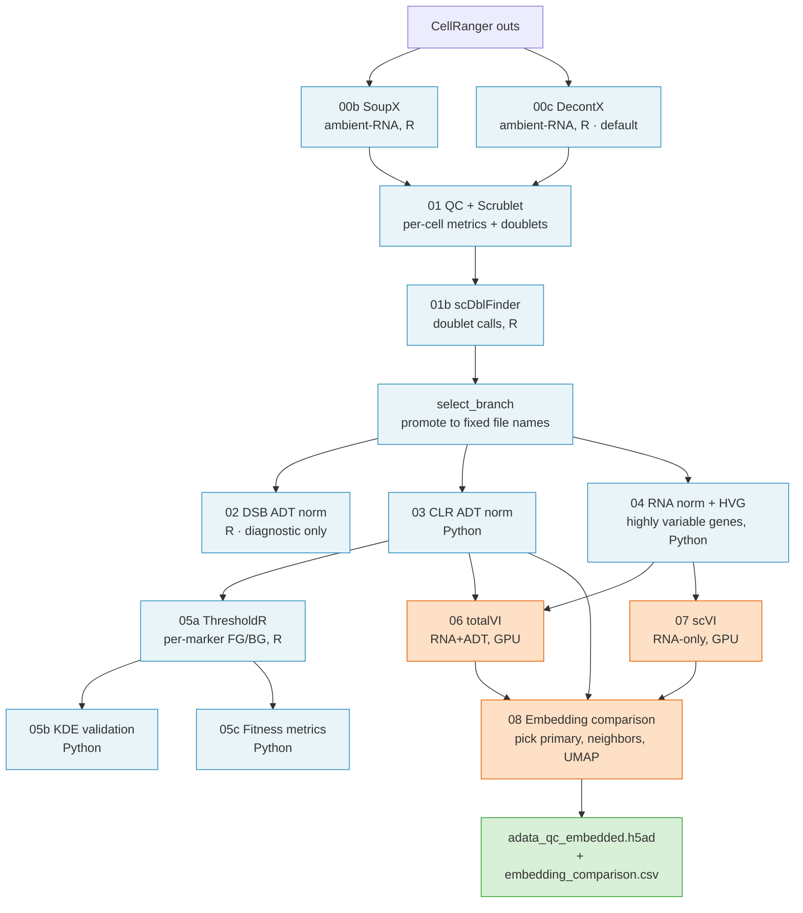

# citeseq-nf: Generic CITE-seq Preprocessing + Embedding Pipeline

This is a Nextflow pipeline for the generic part of a CITE-seq analysis.
CITE-seq measures RNA and surface proteins (ADT tags) in the same single
cell. The pipeline runs five things: ambient-RNA decontamination, per-cell QC,
ADT/RNA normalization, marker-threshold gating, and joint totalVI + scVI
integration. Ambient RNA is free-floating RNA that leaks into every droplet.
A last step then picks one primary embedding. The pipeline produces one
final file, `adata_qc_embedded.h5ad`. Downstream, study-specific analyses
read that file and continue from there.

**If you just inherited this repository, read [Handover notes](#handover-notes)
first.** It says plainly what has been tested on real data and what has not.

## What the pipeline does

- Fans out over the libraries. "Fan-out" means the same steps run once per
  CellRanger library, in parallel (decontamination → QC → normalization →
  gating).
- Integrates the full cohort with totalVI (joint RNA+ADT) and scVI (RNA-only)
  on GPU.
- Compares the two embeddings and produces a single UMAP + neighbor graph on
  the chosen primary embedding.

## Pipeline DAG

The pipeline fans out per library through gating, then joins the libraries
for embedding. Phase A (QC + normalization + gating) runs once per library.
Phase B (totalVI + scVI + embedding comparison) runs once on the cohort.



The CLR output (step 03) is used more widely than most of the arrows suggest.
The diagram draws its three main consumers: step 05a, step 06 and step 08.
Step 08 reads it as one of three inputs, next to the totalVI and scVI files:
see `modules/step08_embedding.nf`. Steps 05b and 05c read it too, and step 05c
also reads the RNA-normalized file from step 04. Those last three arrows are
left out to keep the picture readable.

## Handoff contract

At step 08 the pipeline produces two terminal artifacts that calling studies
consume:

| Artifact | Relative path (under `--outdir`) | Role |
|---|---|---|
| `adata_qc_embedded.h5ad` | `data/processed/` | The main input for downstream classification and hypothesis testing. Contains `X_umap`, `X_totalVI`/`X_scVI`, `uns['primary_embedding']`, neighbor graph, HVG (highly variable gene) + CLR ADT layers. |
| `embedding_comparison.csv` | `results/phase2_embedding/` | Audit trail: which embedding was chosen and why. Exactly three rows. `batch_silhouette`, then `bio_silhouette_<MARKER>` (or `bio_silhouette_skipped` when no marker is set), then `decision`. A silhouette score measures how well separated two groups of cells are. |

The filenames are the interface. Any downstream step that reads
`adata_qc_embedded.h5ad` from the configured processed-data directory is a
valid consumer. No code-level imports required.

## Downstream: bring your own

citeseq-nf ends at step 08. Cell-type classification, hypothesis testing,
panel-specific gating, and manuscript figures are not in this repository.
They belong in your own study repo. That repo reads
`adata_qc_embedded.h5ad` from `{outdir}/data/processed/` and continues with
plain Python or R calls. No import from citeseq-nf is needed.

## Prerequisites

The first two items are required. The pipeline does not run without them. The
last two are strongly recommended, not required.

| What | Required? | Version | Why you need it |
|---|---|---|---|
| Nextflow | yes | DSL 2. Only 25.10.4 has ever been used. The repository sets no minimum version, so nothing stops you from trying an older one. | Runs the workflow. |
| A conda-style environment | yes | Built from `env/environment.yml`, then topped up by `env/r_extra.R`. | Holds every Python and R package the step scripts use. |
| A GPU | recommended | Any CUDA GPU. The pinned `torch` wheel is the CUDA 12.4 build. | Step 06 (totalVI) and step 07 (scVI) train much faster on GPU. A CPU also works, but it is very slow. |
| A batch scheduler | recommended | SGE needs no extra setup. | Production runs. The repository also includes `-profile local`, so you can run without any scheduler. For Slurm, AWS Batch or anything else, copy and edit `conf/sge.config`. See Cluster portability. |

The environment is **not shipped** as a ready-made folder. You build it once
from the files in `env/`, then pass its path with `--conda_env`. The
Installation section below has the steps.

Two things this pipeline does **not** need:

- **No standalone `scrublet` package.** Scrublet is the doublet detector
  (it finds droplets that hold two cells instead of one). scanpy 1.11 ships
  it inside itself, and `scripts/python/step01_qc.py` calls it as
  `sc.pp.scrublet`. Installing a separate `scrublet` package would conflict
  with scanpy.
- **No `celda` call.** `scripts/R/step00c_decontx.R` loads `decontX`, the
  standalone Bioconductor package. `celda` is the parent project of DecontX,
  and it is installed only because `decontX` depends on it. No script loads it.

### Python packages

Python is 3.10.19. Every version below is quoted from `env/environment.yml`.

Imported by name in `scripts/config.py` or `scripts/python/*.py`:

| Package | Version | Where it is used |
|---|---|---|
| `scanpy` | 1.11.5 | every step script (`import scanpy as sc`) |
| `anndata` | 0.11.4 | step 08 |
| `numpy` | 2.2.6 | most step scripts |
| `pandas` | 2.3.3 | most step scripts |
| `scipy` | 1.15.2 | sparse matrices, `gaussian_kde` (step 05b, 05c), `find_peaks` (step 05b) |
| `scikit-learn` | 1.7.2 | `GaussianMixture` (step 05c), `silhouette_score` (step 08) |
| `matplotlib-base` | 3.10.8 | all figures |
| `h5py` | 3.15.1 | step 00b reads `.h5` matrices directly |
| `pyyaml` | 6.0.3 | `scripts/config.py` reads the panel YAML |
| `scvi-tools` | 1.3.3 | step 06 totalVI, step 07 scVI (`import scvi`) |
| `soupx-python` | 0.3.0 | step 00b (`import soupx`). This is the **Python** SoupX port, not the R `SoupX` package. |

Never imported by name, but a step fails without them:

| Package | Version | Why it is needed |
|---|---|---|
| `torch` | 2.5.1 | the deep-learning backend `scvi-tools` runs on. Pinned below 2.6 so the Lightning version `scvi-tools` pulls in keeps working. |
| `mudata` | 0.3.3 | data container `scvi-tools` uses |
| `scikit-misc` | 0.5.2 | needed by `sc.pp.highly_variable_genes(flavor="seurat_v3")` in step 04 |
| `scikit-image` | 0.25.2 | threshold search inside `sc.pp.scrublet` in step 01 |
| `leidenalg` | 0.11.0 | `sc.tl.leiden` in steps 06 and 07 |
| `python-igraph` | 1.0.0 | graph backend for `leidenalg` |
| `umap-learn` | 0.5.11 | `sc.tl.umap` in steps 06, 07 and 08 |
| `pynndescent` | 0.5.13 | nearest-neighbour backend for `umap-learn` |
| `statsmodels` | 0.14.6 | required by `soupx-python` |
| `numba` | 0.63.1 | just-in-time compiler that scanpy and `umap-learn` use |
| `seaborn-base` | 0.13.2 | used by some scanpy plotting calls |

`env/environment.yml` pins a few more small helpers that scanpy and `h5py`
need: `natsort` 8.4.0, `tqdm` 4.67.3, `session-info2` 0.3 and `hdf5` 1.14.6.

`rpy2` 3.6.6 is also pinned. No step script imports it today. It stays because
it was part of the validated environment.

### R packages

R is 4.4.3, with Bioconductor release 3.20. Versions come from
`env/environment.yml` unless the table says otherwise.

| Package | Version | Loaded by |
|---|---|---|
| `decontX` | 1.4.1 (from `env/r_extra.R`) | step 00c, ambient-RNA removal |
| `rhdf5` | 2.50.2 (from `env/r_extra.R`) | steps 00c and 01b, reads 10x `.h5` matrices |
| `scDblFinder` | 1.23.4 | step 01b, doublet calling |
| `SingleCellExperiment` | 1.28.0 | step 01b container |
| `dsb` | 2.0.1 | step 02, ADT denoising |
| `ThresholdR` | 0.1.0 (vendored, see below) | step 05a, per-marker gating |
| `ggplot2` | 4.0.2 | step 05a fit plots |
| `Matrix` | 1.7-4 | steps 00c, 01b, 02 |
| `Seurat` | 5.4.0 | `Seurat::Read10X_h5` in steps 00c and 02 |
| `jsonlite` | 2.0.0 | `scripts/config.R` |
| `yaml` | 2.3.12 | `scripts/config.R` |

These packages are installed as dependencies. No script loads them.

| Package | Version | Needed by |
|---|---|---|
| `celda` | 1.22.1 (from `env/r_extra.R`) | `decontX` |
| `mclust` | 6.1.2 | called from inside `ThresholdR` |
| `mixtools` | 2.0.0.1 | called from inside `ThresholdR` |
| `foreach` | 1.5.2 | called from inside `ThresholdR` |
| `limma` | 3.62.1 | `dsb` |
| `magrittr` | 2.0.4 | `dsb` |
| `remotes` | 2.5.0 | `env/r_extra.R` |

Two notes on the R side:

- **`ThresholdR` is on no conda channel.** It lives on GitHub only.
  `env/r_extra.R` installs it. `env/vendor/ThresholdR_0.1.0.tar.gz` is a
  rebuild of the build the reference run of 2026-04-28 used, not the original
  source. No original source tarball was archived, so the package was rebuilt
  by deparsing the installed package database. The executed code was checked
  function by function and is identical. The source comments and the code
  formatting are not the original ones. Read `env/vendor/README.md` before you
  choose between the two sources. This is the most fragile dependency in the
  whole stack. See Handover notes.
- **`env/r_extra.R` reinstalls five R packages** that `env/environment.yml`
  does not supply at the recorded version. This is expected.

  | Package | `env/environment.yml` pins | Recorded version | Gap |
  |---|---|---|---|
  | `rhdf5` | 2.50.0 | 2.50.2 | two patch releases |
  | `celda` | 1.22.0 | 1.22.1 | one patch release |
  | `decontX` | 1.4.0 | 1.4.1 | one patch release |
  | `Rhdf5lib` | not pinned at all | 1.28.0 | conda pin missing |
  | `rhdf5filters` | not pinned at all | 1.18.1 | conda pin missing |

## Installation

There **is** a build step. Cloning the repo is not enough. Follow all five
steps. `env/README.md` has the long version, including how long each step
takes.

**1. Clone the repo and point `CITESEQ_NF` at it.**

```bash
git clone <repo-url>/citeseq-nf.git
export CITESEQ_NF=$(realpath citeseq-nf)
```

**2. Build the conda environment.** Run this from the top folder of the repo.
Pick the line that matches your tool. This installs about 440 packages and
takes 5 to 15 minutes.

```bash
micromamba create -f env/environment.yml     # or: mamba env create -f env/environment.yml
                                             # or: conda env create -f env/environment.yml
micromamba activate citeseq-nf
```

**3. Add the R packages conda cannot supply.** Keep the environment active.
This installs `ThresholdR` and reinstalls the five R packages listed above.
Allow ten minutes or more, because `Rhdf5lib` compiles the HDF5 C library
from source.

```bash
Rscript env/r_extra.R
```

To install the vendored `ThresholdR` build instead, run
`THRESHOLDR_SOURCE=vendor Rscript env/r_extra.R`. See `env/vendor/README.md`
for why the two builds can differ.

> **Warning: the default path needs one more package, and step 4 will not
> catch it.**
>
> By default `env/r_extra.R` installs `ThresholdR` from upstream GitHub. The
> upstream build calls the `AdaptGauss` R package inside `get_thresholds()`.
> conda has no `AdaptGauss` build for R 4.4, so `env/environment.yml` does not
> install it.
>
> `ThresholdR` does not load its dependencies when the library loads. It loads
> them later, inside each function, with `require()`. So the check in step 4
> below passes. The run then fails hours later, in step 05a, on the first real
> data.
>
> Pick one of these two fixes before you start a run:
>
> - install the missing package: `Rscript -e 'install.packages("AdaptGauss")'`;
> - or install the vendored build with
>   `THRESHOLDR_SOURCE=vendor Rscript env/r_extra.R`. The vendored build uses
>   its own private helper for that step and never calls `AdaptGauss`.
>
> `env/vendor/README.md` and `env/README.md` describe both fixes.

**4. Verify the environment.** Run these three commands. The first prints your
Nextflow version. The other two print `OK` when every package is present, and
otherwise stop with an error that names the missing package. Those last two
are the same two checks that `env/README.md` calls the verification commands.
Do not start a run until both print `OK`.

```bash
nextflow -version

python -c "import scanpy, anndata, scvi, torch, soupx, skmisc, skimage, h5py, yaml; print('OK')"

Rscript -e 'suppressPackageStartupMessages({library(dsb); library(decontX); library(ThresholdR); library(scDblFinder); library(SingleCellExperiment); library(rhdf5); library(Matrix); library(ggplot2)}); cat("OK\n")'
```

**5. Print the environment path.** You pass it to every run with
`--conda_env`. Nextflow does not find the environment by itself.

```bash
python -c "import sys, pathlib; print(pathlib.Path(sys.prefix))"
```

You now have `--python` and `--rscript` for free: the pipeline builds both
from `--conda_env`.

## Quick start

Set `CITESEQ_NF` to the cloned repo, then call `run.sh` with the five
required params (`--project_root`, `--outdir`, `--conda_env`, `--panel`,
`--data_root`) and your SGE GPU queues.

A full run also needs to know how many libraries to process. Pass
`--sample_metadata_json` (the pipeline counts its keys) or `--n_libraries N`.
Without one of the two, the run stops at the start of Phase A.

Every example below passes `--conda_env /path/to/envs/citeseq-nf`. That is the
environment name in `env/environment.yml`. The name is your choice: pass
whatever path your own environment sits at.

```bash
module load nextflow/25.10.4
export CITESEQ_NF=/path/to/citeseq-nf

${CITESEQ_NF}/run.sh run \
    ${CITESEQ_NF}/main.nf \
    -profile sge \
    --project_root /path/to/your/study \
    --outdir       /path/to/your/study \
    --conda_env    /path/to/envs/citeseq-nf \
    --panel        /path/to/your/study/panels/your_panel.yaml \
    --data_root    /path/to/your/cellranger_outs \
    --sge_gpu_totalvi_queue 'gpu.q@<your-gpu-host>' \
    --sge_gpu_scvi_queue    'gpu.q@<your-gpu-host>' \
    --forced_hvgs_file     /path/to/your/study/panels/your_forced_hvgs.txt \
    --sample_metadata_json /path/to/your/study/panels/sample_metadata.json
```

The pipeline writes to:

- `{outdir}/data/processed/`: h5ad checkpoints (including the terminal
  `adata_qc_embedded.h5ad`)
- `{outdir}/results/`: CSVs, QC summaries, `embedding_comparison.csv`
- `{outdir}/models/`: trained totalVI + scVI models
- `{outdir}/figures/`: QC plots, UMAP overviews, threshold diagnostics
- `{outdir}/logs/nextflow/` holds `timeline.html` and `report.html`

The Nextflow run log goes somewhere else. `run.sh` writes `.nextflow.log*`
into `logs/nextflow/` **inside the repo**, so it does not clutter the
directory you launched from. Set `CITESEQ_LOG_DIR` to send it elsewhere:

```bash
export CITESEQ_LOG_DIR=/path/to/your/logs
```

Always use the `run.sh` wrapper instead of bare `nextflow`. Bare `nextflow`
drops `.nextflow.log*` in the current directory.

```bash
# Local executor: useful for interactive testing on a small library
${CITESEQ_NF}/run.sh run \
    ${CITESEQ_NF}/main.nf \
    -profile local \
    --project_root /path/to/study --outdir /path/to/study \
    --conda_env /path/to/envs/citeseq-nf \
    --panel /path/to/your_panel.yaml \
    --data_root /path/to/cellranger_outs \
    --n_libraries 2

# Resume from cache (instant if inputs + params unchanged)
${CITESEQ_NF}/run.sh run \
    ${CITESEQ_NF}/main.nf \
    -profile sge -resume \
    --project_root /path/to/study --outdir /path/to/study \
    --conda_env /path/to/envs/citeseq-nf \
    --panel /path/to/your_panel.yaml \
    --data_root /path/to/cellranger_outs \
    --sample_metadata_json /path/to/sample_metadata.json
```

## Inputs

| Input | Required? | How to set | Notes |
|---|---|---|---|
| CellRanger data root | **yes** | passed via `--data_root` | There is **no default**. `main.nf` stops at launch if you omit it. The directory holds one subdirectory per library. Each `<library_id>/` holds that library's `raw_feature_bc_matrix.h5` and `filtered_feature_bc_matrix.h5`, plus the graph-based clusters in one of the two layouts below. |
| `sample_metadata.json` | optional, but see note | passed via `--sample_metadata_json` | JSON dict: `library_id` → `{donor, age, age_group, timepoint, replicate}`. Unknown keys ignored. The pipeline also counts its keys to learn how many libraries to fan out over. If you skip it, pass `--n_libraries N` instead. |
| `forced_hvgs.txt` | optional | passed via `--forced_hvgs_file` | One gene symbol per line. `#` comments and blank lines are ignored. These genes always enter the HVG set, even when the `seurat_v3` ranking does not pick them. `seurat_v3` is the scanpy method that picks variable genes. |

### Two supported data layouts

Steps 00b and 00c need the CellRanger graph-based clusters. Both layouts
below work, and you do not have to tell the pipeline which one you have. It
looks for the first one that exists, per library.

| Layout | Where the clusters live |
|---|---|
| Local `cellranger count` tree | `<data_root>/<library_id>/[outs/]analysis/clustering/{gene_expression_graphclust,graphclust}/clusters.csv` |
| 10x Cloud Analysis download | `<data_root>/<library_id>/analysis.tar.gz`, member `clustering/{gene_expression_graphclust,graphclust}/clusters.csv` |

The two `.h5` matrix files sit at `<data_root>/<library_id>/` in both cases.
If neither layout is found, the step stops and prints every path it searched.

<details><summary>Example sample_metadata.json + forced_hvgs.txt</summary>

```json
{
  "Lib01": {"donor": "Donor_A", "age": 25, "age_group": "young", "timepoint": "d0", "replicate": 1},
  "Lib02": {"donor": "Donor_B", "age": 68, "age_group": "aged",  "timepoint": "d7", "replicate": 1}
}
```

```
# Cytotoxicity markers
GNLY
NKG7
PRF1

# Transcription factors
GATA3
TBX21
```

</details>

## Entry points

Skip earlier steps by entering at a checkpoint with pre-computed inputs.

| Entry | What it runs | Required inputs (beyond the always-required params) |
|---|---|---|
| `(default)` / `from_cellranger` | Full pipeline: Phase A QC → Phase B embed | `--sample_metadata_json` or `--n_libraries`. Phase A stops with an error when you pass neither. |
| `from_qc` | Normalization + gating + embed | `--adata_qc`, `--adata_adt_raw`, `--adt_counts_for_thresholdr` |
| `from_clr` | Stage CLR file (no-op validation) | `--adata_qc_clr` |
| `clr_only` | Step 03 CLR only (POC) | `--adata_qc`, `--adata_adt_raw` |
| `from_hvg` | totalVI + scVI + embedding comparison | Defaults to `{project_root}/data/processed/adata_qc_hvg.h5ad` + `{project_root}/data/processed/adata_qc_clr.h5ad`; override with `--adata_qc_hvg` / `--adata_qc_clr` |
| `from_totalvi_scvi` | Step 08 only, against existing totalVI + scVI outputs | Defaults to `{project_root}/data/processed/adata_totalvi.h5ad` + `adata_scvi.h5ad` + `adata_qc_clr.h5ad`; override with `--adata_totalvi` / `--adata_scvi` / `--adata_qc_clr` |

The two default paths above are built from `--project_root`, not from
`--outdir`. When the two params differ, pass the checkpoint files by hand.

```bash
# Reuse existing embeddings, rerun only step 08
${CITESEQ_NF}/run.sh run \
    ${CITESEQ_NF}/main.nf \
    -profile sge -entry from_totalvi_scvi \
    --project_root /path/to/study --outdir /path/to/study \
    --conda_env /path/to/envs/citeseq-nf \
    --panel /path/to/your_panel.yaml \
    --data_root /path/to/cellranger_outs
```

## Parameters

All Nextflow params default to `null` unless noted. Defaults for *scientific*
values (QC thresholds, normalization parameters, and so on) live in
`scripts/config.py` and `scripts/config.R`. The Nextflow layer exports an
environment variable only when you pass the matching param. So when you pass
nothing, the default in `config.py` and `config.R` stays active.

### Required

| Param | When required | Meaning |
|---|---|---|
| `--project_root` | always | Absolute path to the calling study's root. Anchors the output locations. |
| `--outdir` | always | Where to write all pipeline outputs. Usually equal to `--project_root`. |
| `--conda_env` | always | Absolute path to the CITE-seq conda/mamba environment. `--python` and `--rscript` default to `${conda_env}/bin/python` and `${conda_env}/bin/Rscript`. |
| `--panel` | always | Path to an ADT panel YAML. See `panels/example_panel.yaml` for the schema. |
| `--data_root` | always | Path to the CellRanger input root. It holds one subdirectory per library, and each one holds that library's `raw_feature_bc_matrix.h5` and `filtered_feature_bc_matrix.h5`, plus the graph-based clusters. **There is no default.** `main.nf` stops at launch if you omit it. Both a local `cellranger count` tree and a 10x Cloud Analysis download (`analysis.tar.gz`) work, and the pipeline detects which one you have. See Inputs. Exported as `CITESEQ_DATA_ROOT`. |
| `--sge_gpu_totalvi_queue` | GPU steps under `-profile sge` | SGE queue spec for the totalVI GPU step, e.g. `gpu.q@<host>`. |
| `--sge_gpu_scvi_queue` | GPU steps under `-profile sge` | SGE queue spec for the scVI GPU step, e.g. `gpu.q@<host>`. |

### Optional overrides

| Param | Default | Meaning |
|---|---|---|
| `--python` | `${conda_env}/bin/python` | Override the Python interpreter used by Python step modules. |
| `--rscript` | `${conda_env}/bin/Rscript` | Override the Rscript interpreter used by R step modules. |
| `--forced_hvgs_file` | *(empty)* | Text file with one gene symbol per line. Blank lines and `#`-prefixed comments ignored. Empty means the `seurat_v3` auto-selection alone picks the HVGs. |
| `--sample_metadata_json` | *(empty)* | JSON dict mapping `library_id` → metadata object (see Inputs). Phase A also counts its keys to set the number of libraries. |
| `--n_libraries` | *(counted from `--sample_metadata_json`)* | How many libraries Phase A fans out over. It must be a whole number, 1 or greater. Use it for a pilot run on a subset, or when you have no metadata JSON. Nothing is hardcoded: without either this param or `--sample_metadata_json`, the default and `from_cellranger` entry points stop with an error. Entry points that skip Phase A do not need it. |
| `--branch` | `decontx` | Decontamination branch to use downstream (`decontx` or `soupx`). Nothing is auto-detected. When you pass nothing, `main.nf` and `subworkflows/phase_a_qc.nf` both fall back to the fixed value `decontx`. |
| `--run_both_branches` | `false` | Run both SoupX and DecontX (for comparison); default runs only the selected branch. |
| `--qc_mad_n_mads` | *(config default)* | QC MAD threshold for per-cell metrics. Exported as `CITESEQ_QC_MAD_N_MADS`. |
| `--biological_separation_marker` | *(skipped)* | One ADT marker name. Step 08 uses it as the biological-separation axis when it scores the totalVI and scVI silhouettes. Cells split on `ADT_<marker>_fg_prob > 0.5`. Empty = step 08 emits `bio_silhouette_skipped` and falls back to batch-mixing alone. Exported as `CITESEQ_BIOLOGICAL_SEPARATION_MARKER`. |

### Checkpoint inputs (used by entry points)

| Param | Used by |
|---|---|
| `--adata_qc` | `from_qc` |
| `--adata_adt_raw` | `from_qc`, `clr_only` |
| `--adt_counts_for_thresholdr` | `from_qc` |
| `--adata_qc_clr` | `from_clr`, `from_hvg`, `from_totalvi_scvi` |
| `--adata_qc_hvg` | `from_hvg` |
| `--adata_totalvi` | `from_totalvi_scvi` |
| `--adata_scvi` | `from_totalvi_scvi` |

### Override mechanism

Overrides flow Nextflow → env var → `config.py`:

```bash
${CITESEQ_NF}/run.sh run \
    ${CITESEQ_NF}/main.nf -profile sge \
    --project_root /path/to/study --outdir /path/to/study \
    --conda_env /path/to/envs/citeseq-nf \
    --panel /path/to/your_panel.yaml \
    --data_root /path/to/cellranger_outs \
    --qc_mad_n_mads 3
```

The export does not come from the QC module. `modules/step01_qc.nf` exports
nothing. The line lives in the global `process.beforeScript` block in
`nextflow.config`, so `CITESEQ_QC_MAD_N_MADS=3` is exported for **every**
process in the run. `config.py` then reads it via
`os.environ.get("CITESEQ_QC_MAD_N_MADS", "5")`.

## Configuration

### Profiles

| Profile | Executor | Use case |
|---------|----------|----------|
| `local` | Local machine | Interactive testing, small steps |
| `sge`   | SGE cluster | Production runs, GPU steps |

### Cluster portability

The default `-profile sge` config assumes an SGE executor with the `smp`
parallel environment and GPU access via a `-q <queue>` clusterOption. Forks
on other schedulers should:

1. Edit `conf/sge.config`. Change the executor, parallel environment, and
   GPU clusterOptions. For Slurm / AWS Batch / etc., swap this file for a
   `slurm.config` / `awsbatch.config` and add a matching profile in
   `nextflow.config`.
2. Pass `--conda_env /path/to/envs/citeseq-nf` at invocation.
3. Pass `--sge_gpu_totalvi_queue` and `--sge_gpu_scvi_queue` (SGE only) for
   the GPU steps.
4. Optionally set the work directory via `-w <dir>` on the `nextflow` CLI or
   by exporting `NXF_WORK`. Defaults to `./work` (project-relative).

### Resource labels

Assigned to a process via `label 'cpu_small'` etc. Defined in
`conf/resources.config`.

| Label | CPUs | Memory | Time |
|-------|------|--------|------|
| `cpu_small` | 2 | 8 GB | 1h |
| `cpu_medium` | 4 | 16 GB | 2h |
| `cpu_large` | 8 | 32 GB | 4h |
| `gpu_totalvi` | 4 | 64 GB | 4h (queue from `--sge_gpu_totalvi_queue`) |
| `gpu_scvi` | 8 | 12 GB | 4h (queue from `--sge_gpu_scvi_queue`) |

### Environment labels

| Label | Conda path |
|-------|-----------|
| `env_cite_seq` | Set by required `--conda_env`. |

## Antibody panel configuration

Copy `panels/example_panel.yaml`. Replace the placeholder marker names
(`MARKER_A`, `MARKER_B`, …) and the gene lists with your own panel. Pass the
file with `--panel /path/to/your_panel.yaml`.

`scripts/config.py` checks the YAML the moment it is imported. It checks
that all required keys are there and that the marker names agree with each
other. A bad panel file stops the script right away, before it reads any
data.

The panel file drives four things:

- the remap from CellRanger feature names to canonical names (the short
  marker names used everywhere downstream);
- the functional, ThresholdR and KDE marker subsets;
- the reference markers for BIC, a score used to choose how many mixture
  components to fit;
- the RNA-concordance map.

<details><summary>Schema reference (8 keys, 5 required / 3 optional)</summary>

| Key | Required? | Meaning |
|---|---|---|
| `cellranger_names` | yes | Feature names as they appear in `feature_bc_matrix.h5`. |
| `rename_map` | yes | CellRanger name → canonical short name used downstream. |
| `functional` | yes | Markers that passed reagent QC (subset of canonical names). |
| `thresholdr` | yes | Markers entering ThresholdR GMM gating. |
| `thresholdr_reference` | yes | Non-empty subset of `thresholdr`. It drives the BIC threshold. Pick markers known to be bimodal (two clear peaks). |
| `fgprob_override` | no | Markers forced to use totalVI fg_prob instead of ThresholdR (e.g., very rare populations). |
| `kde_validate` | no | Markers included in the KDE gating diagnostic. |
| `rna_concordance` | no | Per-marker RNA validators (`positive` / `negative` gene lists + `description`). Keys must be in `functional`. |

**Validation rules** enforced at load:

- Every marker in `functional`, `thresholdr`, `thresholdr_reference`,
  `fgprob_override` and `kde_validate` must appear as a value in
  `rename_map`.
- Every key of `rename_map` must appear in `cellranger_names`.
- `thresholdr_reference` must be a non-empty subset of `thresholdr`.
- Every key of `rna_concordance` must be in `functional`.

</details>

## Tests

`tests/` holds four job scripts for SGE (Sun Grid Engine), the batch
scheduler this pipeline was built on. You submit each one with `qsub`. None
of them hardcode a path, a user name, a host name, or a queue name. You pass
all of that in as environment variables.

| Script | What it does | GPU? | Rough time |
|---|---|---|---|
| `run_full_pipeline.sge` | Runs the whole pipeline, then checks that the five main output files exist. This is the normal batch driver, not really a test. | yes | about 3 h for 16 libraries |
| `validate_citeseq_nf_e2e.sge` | Runs step 08 directly to build a fresh reference, runs the same work through Nextflow, then compares the two. | no, in the default mode | 15 to 40 min |
| `validate_phase_a.sge` | Compares the Phase A output files against a known-good copy that you place at `<PROJECT>/data/processed/phase_a_baseline/`. | only if it runs the pipeline | about 10 min with `SKIP_NEXTFLOW=1` |
| `validate_phase_b_gpu.sge` | Retrains totalVI and scVI, then checks the new outputs against the old numbers with a tolerance. | yes | 2 to 3 h of training |

**Run them in this order.**

1. `validate_phase_a.sge`, with `N_LIBRARIES` set to 2 or 3. This is a small
   pilot on real data. `validate_phase_a.sge` runs the pipeline itself unless
   you set `SKIP_NEXTFLOW=1`, so it produces the Phase A files it then checks.
   Setup problems show up here first, and on a few libraries they show up in
   minutes. Read the two warnings in Handover notes before you submit.
2. `run_full_pipeline.sge`, once the pilot is clean. This is the normal batch
   driver. It runs the whole pipeline on the full cohort and gives the later
   checks something to work with.
3. `validate_citeseq_nf_e2e.sge`. The cheapest check, and it needs no GPU.
4. `validate_phase_a.sge` again, now with `SKIP_NEXTFLOW=1`. It only compares
   files, so it is fast.
5. `validate_phase_b_gpu.sge` last, because it retrains both models on a GPU.

This order matches the advice in Handover notes.

**Create `logs/` before you submit.** The `#$ -o` line in every script writes
to `logs/<name>_$JOB_ID.log`, and that path is relative to the directory you
submit from. SGE loses or rejects the job when the directory is missing. The
repository ships an empty `logs/.gitkeep` file, so `logs/` exists right after
a clone. Submit from the repository root:

```bash
qsub -V tests/validate_citeseq_nf_e2e.sge
```

`qsub -V` passes your exported variables into the job.

`tests/README.md` has the full variable contract: every variable each script
reads, which ones are required by which script, the switches
(`SKIP_NEXTFLOW`, `SKIP_BASELINE`, `RUN_FULL_DEFAULT`), and an honest list of
what these tests do **not** cover.

## Reference outputs

`tests/baseline/` holds nine small CSV tables from the reference run of
2026-04-28 (16 libraries, 6 donors). They are committed so you can compare a
fresh run against something that is known to have worked.

Two of the nine are older. `thresholdr_fitness_metrics.csv` and
`kde_vs_thresholdr_comparison.csv` are dated 2026-04-02, because the gating
steps read a stale input file that day. See "Two baseline tables are older
than the rest" in Handover notes.

| Area | Files |
|---|---|
| Cell QC and doublets | `qc_summary.csv`, `doublet_comparison.csv`, `doublet_comparison_decontx.csv` |
| Ambient RNA removal | `decontx_summary.csv` |
| ADT marker gating | `thresholdr_fitness_metrics.csv`, `kde_vs_thresholdr_comparison.csv` |
| Embedding choice | `embedding_comparison.csv` |
| totalVI training | `totalvi_training_history.csv`, `totalvi_full_history.csv` |

Two things to know before you use them.

**Donor identifiers are anonymized.** The real donor numbers were replaced
with `donor_01` to `donor_06`. Age group, timepoint, replicate, sample
number, and every numeric value are unchanged. The mapping back to the real
donor IDs is not stored in this repository and cannot be recovered from it.
No file holds a cell barcode, a file path, a host name, or a user name.

**A new run will not reproduce these numbers exactly.** totalVI and scVI are
stochastic: they start from random weights, shuffle the data at random, and
split train and validation at random. Two runs on the same input give
different numbers. Everything computed after them (silhouette scores, the
neighbour graph, UMAP, clustering) inherits that randomness. So compare the
*shape* of the tables and the *magnitude* of the values, not the exact
digits. A sign flip or a 10x change is a real warning. A different third
decimal is not.

`docs/reference_run.md` records that run in full: software versions, timings,
cell counts, gating verdicts, and the embedding decision.
`tests/baseline/README.md` describes each file in one line. Read the warning
at the top of `docs/reference_run.md` first. The exact code revision that
produced these tables was never committed and no longer exists.

## Handover notes

This repository has changed owner. This section says what has been checked
and what has not. Read it before you trust any part of the pipeline.

### What is proven

The pipeline completed one full run on **2026-04-28**. It processed 16
libraries in **2 hours 43 minutes** on an SGE cluster, from CellRanger input
to `adata_qc_embedded.h5ad`. All 61 tasks really ran. Nothing came from
cache, so that time is a true end-to-end time. `docs/reference_run.md`
records the outputs, the timings, and the software versions of that run. Its
small result tables are in `tests/baseline/`.

That run was **not** clean from start to finish. The gating steps read a
stale input file from an earlier run, so two of the nine baseline tables do
not describe the 2026-04-28 data. See "Two baseline tables are older than the
rest" further down.

### What is not proven

**That run used the older, study-specific code. It did not use the code in
this repository.** The code here is the generic version. The hardcoded study
paths, the fixed library count of 16, and the study-specific defaults were
all removed.

The generic code has passed two checks:

- a Nextflow dry run on all seven entry points (default, `from_cellranger`,
  `from_qc`, `from_clr`, `clr_only`, `from_hvg`, `from_totalvi_scvi`);
- a syntax check of every Python and R step script. They all compile.

Neither check touches real data. A dry run only proves that Nextflow can
build the workflow graph and that the parameters resolve.

**The generic code has never been run end to end on real data.** The first
real run is still ahead of you. Expect it to stop once or twice on small
things such as a path, a queue name, or a missing R package. That is a setup
problem, not a sign that the method is wrong.

### The environment has not been built from scratch

`env/environment.yml` was derived from a working installation, not written by
hand, and the conda solver was asked to check it with
`micromamba create --dry-run`. The solve is clean. But **nobody has built the
environment from that file on a clean machine.** Expect the first build to
need small fixes. `env/README.md` has the steps, the timings, and the known
problems.

**Some R and Bioconductor pins are guesses, not records.** A few of those
packages were installed outside conda in the original environment, through
`BiocManager` or `remotes`. conda never recorded a version for them. Their
pins in `env/environment.yml` are the closest matching bioconda build
instead. The header of `env/environment.yml` says there are six such pins.
Each of those six lines carries the word `mapped` in its comment, so you can
find them. This is the class of pin most likely to fail or to install a
slightly different version.

**`scDblFinder` 1.23.4 is the second fragile pin.** It sits in
`env/environment.yml` and only there. `env/r_extra.R` leaves it out on
purpose. Version 1.23.4 comes from the Bioconductor development line. The 3.20
release line only offers 1.20.2, so it can never give you 1.23.4. There is
no vendored copy either. If the conda pin ever stops resolving, you have no
fallback, and step 01b (doublet calling) is what breaks.

### ThresholdR is the most fragile dependency

`ThresholdR` does the per-marker ADT gating in step 05a. It is **not on CRAN
and not on Bioconductor**. It exists only on GitHub, so the pipeline depends
on one outside repository staying online.

There are two protections:

- `env/r_extra.R` installs it and pins the four packages it calls at runtime.
- `env/vendor/ThresholdR_0.1.0.tar.gz` is a rebuild of the build the reference
  run used. It is kept in this repository in case upstream disappears. No
  original source tarball was archived. The package was rebuilt by deparsing
  the installed package database, so its comments and its formatting are not
  the original ones. Each function was then compared against the installed
  original, one by one, and the executed code is identical.

Read `env/vendor/README.md` before you choose between the two sources. The
vendored copy is **not** identical to upstream. It uses a different routine
to compute the cut point, so the `bi_cut`, `tri_cut1` and `tri_cut2` columns
can differ between the two builds. The columns that step 05a actually gates
on are computed the same way in both.

**The upstream source needs a package conda cannot install, and no check
catches it.** Upstream `ThresholdR` calls `AdaptGauss` inside
`get_thresholds()`. conda has no `AdaptGauss` build for R 4.4, so
`env/environment.yml` does not install it, and `env/r_extra.R` installs from
upstream by default. `ThresholdR` loads its dependencies with `require()`
inside its own functions, so the verification in Installation step 4 loads
the library and passes. The run then dies in step 05a, on real data, hours
later. Fix it before your first run: install `AdaptGauss` with
`Rscript -e 'install.packages("AdaptGauss")'`, or use the vendored build with
`THRESHOLDR_SOURCE=vendor Rscript env/r_extra.R`, which never calls it.

### Two baseline tables are older than the rest

`thresholdr_fitness_metrics.csv` and `kde_vs_thresholdr_comparison.csv` in
`tests/baseline/` are dated 2026-04-02, not 2026-04-28. In the reference run
the gating steps read a stale input file left over from an earlier run, so
those two tables describe about 161,000 cells while QC that day passed
176,664. `docs/reference_run.md` explains this in the ADT gating section.
Treat those two tables as a guide to shape and order of magnitude only. A
fresh run regenerates all nine tables from the same input.

### What a new owner should do first

1. **Build the environment.** Follow `env/README.md`. It ends with two
   verification commands, one for Python and one for R. They are the same two
   `OK` checks as in Installation step 4 above. Do not start a run until both
   print `OK`. Also settle the `AdaptGauss` question first: see "ThresholdR is
   the most fragile dependency" above.

2. **Run a small subset through Phase A.** Submit
   `tests/validate_phase_a.sge` with `N_LIBRARIES` set to 2 or 3. Phase A is
   where setup problems show up first. Decontamination, QC, doublet calling,
   both ADT normalizations, and marker gating all touch real data there. Two
   or three libraries reach the end of Phase A in minutes. Two honest
   warnings:
   - The pipeline has no "Phase A only" entry point. This script also runs
     Phase B, so you still need the two GPU queue names, and the job keeps
     going for hours after Phase A is done. Read the Phase A output as soon
     as it appears. Cancel the job with `qdel` if the Phase A check was all
     you wanted.
   - On the first attempt there is no
     `<PROJECT>/data/processed/phase_a_baseline/` on disk yet, so the compare
     stage has nothing to compare against. Treat this first pass as a check
     that Phase A runs at all. Afterwards, copy the Phase A output into
     `phase_a_baseline/`. From then on the script is a real regression check,
     and `SKIP_NEXTFLOW=1` makes it cheap.

3. **Then try a full run.** Use `tests/run_full_pipeline.sge`, or `run.sh`
   directly. Compare its result tables against `tests/baseline/` as described
   in Reference outputs.

4. **Commit before you run, every time.** The one thing nobody can recover
   from the 2026-04-28 run is the code that produced it. Nextflow reported a
   revision hash, but that revision was never committed and no longer exists.
   Commit first, run second, and write the commit hash into your run log.

## Troubleshooting

- **`Required param missing: --conda_env`**. Pass `--conda_env` pointing at
  a conda/mamba env with the CITE-seq stack (see Prerequisites).
- **`Required param missing: --panel`** or **`CITESEQ_PANEL_YAML to be set`**.
  Pass `--panel` pointing at your panel YAML. Copy
  `panels/example_panel.yaml` and edit. See Antibody panel configuration.
- **`CITESEQ_DATA_ROOT to be set`**. Pass `--data_root` pointing at the
  directory that holds your per-library CellRanger output folders. There is
  no default. See Inputs.
- **GPU step queue errors under `-profile sge`**. Set
  `--sge_gpu_totalvi_queue` and `--sge_gpu_scvi_queue` (e.g.
  `'gpu.q@<host>'`).
- **`CITESEQ_PYTHON_BIN env var not set`** (from R scripts). Nextflow sets
  this for you. If running an R step manually, export it
  first: `export CITESEQ_PYTHON_BIN=/path/to/python`.
- **`-resume` not picking up cached steps**. Make sure inputs and params
  match exactly. Changing `--qc_mad_n_mads` invalidates everything from
  step 01 onward.
- **`.nextflow.log*` cluttering the working tree**. Use
  `${CITESEQ_NF}/run.sh` instead of bare `nextflow`; it routes logs to
  `logs/nextflow/`.

## Development

<details><summary>Design rules</summary>

1. **Params are override-only.** Defaults for scientific values live in
   `config.py` / `config.R`, not in `nextflow.config`. (Infrastructure paths
   like `python` / `rscript` are derived from `--conda_env` if not
   explicitly set.)
2. **Modules emit outputs through channels**, never by reading from
   `publishDir`.
3. **Distinct artifact per step.** No script overwrites another's output.
4. **Fixed staged file names.** Entry-point inputs use
   `path(file, name: ...)`.
5. **Software by label.** Every process gets `label 'env_cite_seq'`.
6. **Resources by label.** `cpus` / `memory` / `time` from
   `conf/resources.config`.
7. **Validation by invariant for stochastic steps** (totalVI, scVI,
   embedding comparison). Check cell counts to ±0.5%, ELBO and silhouette
   to ±2%, and the same set of embedding keys (the `obsm` slots). Do not
   compare the files exactly.

</details>

<details><summary>How to add a new generic step</summary>

1. Create the script under `scripts/python/` or `scripts/R/`.
2. Create the module in `modules/stepNN_name.nf`:
   - `input: path(file, name: 'staged_name.h5ad')`
   - `output: path('output_name.h5ad', emit: name)`
   - `publishDir` for `data/processed/`, `results/...`, `figures/`
   - `label 'cpu_small'` (or larger) + `label 'env_cite_seq'`
   - Script block: set all four `CITESEQ_*_DIR` env vars, `mkdir -p` output
     dirs, then call the script
3. Wire into `subworkflows/phase_a_qc.nf` or `subworkflows/phase_b_embed.nf`,
   or directly in `main.nf`.
4. Add a contract header (template below).
5. Add a resource label in `conf/resources.config` if a new tier is needed.

**Contract header template** (top-of-module comment):

```groovy
/*
 * Step NN: <name>
 *
 * Contract:
 *   Input:   <staged-input-file-name>
 *   Output:  <output-file-name>
 *   Adds:    <what gets added to adata>
 *
 * Stochastic: Yes|No (determines validation strategy)
 */
```

</details>

<details><summary>Repository layout</summary>

```
citeseq-nf/
├── run.sh                   # Launch wrapper, redirects .nextflow.log* to logs/nextflow/
├── main.nf                  # Top-level workflows + entry points
├── nextflow.config          # Params (override-only) + profiles
├── conf/
│   ├── resources.config     # Resource + environment labels
│   └── sge.config           # SGE executor + GPU queue settings (cluster-specific)
├── modules/                 # One .nf per pipeline step (14 modules)
│   ├── step00b_soupx.nf
│   ├── step00c_decontx.nf
│   ├── step01_qc.nf
│   ├── step01b_scdblfinder.nf
│   ├── step02_dsb.nf
│   ├── step03_clr.nf
│   ├── step04_rna_norm.nf
│   ├── step05a_thresholdr.nf
│   ├── step05b_kde.nf
│   ├── step05c_fitness.nf
│   ├── step06_totalvi.nf
│   ├── step07_scvi.nf
│   ├── step08_embedding.nf  # handoff point, pipeline ends here
│   └── select_branch.nf
├── subworkflows/
│   ├── phase_a_qc.nf        # decontam → QC → normalization → gating
│   └── phase_b_embed.nf     # totalVI + scVI + embedding comparison
├── scripts/
│   ├── config.py            # Generic config (Python) + panel-YAML loader
│   ├── config.R             # R mirror
│   ├── python/              # 9 analytical step scripts (Python)
│   ├── R/                   # 4 analytical step scripts (R)
│   └── admin/
│       └── select_branch.py # Used by modules/select_branch.nf
├── panels/
│   └── example_panel.yaml   # Schema template, copy and edit for your panel
├── env/                     # How to build the software environment
│   ├── README.md            # Build steps, timings, known problems
│   ├── environment.yml      # conda spec (Python + R + pip packages)
│   ├── r_extra.R            # R packages conda cannot supply
│   ├── r_session_info.txt   # Full package list of the working installation
│   └── vendor/              # Vendored ThresholdR source + its provenance
│       └── README.md        # How the tarball was rebuilt, and how it differs
├── tests/                   # 4 SGE scripts + committed reference tables
│   ├── README.md            # Variable contract per script + what is not covered
│   └── baseline/            # 9 anonymized result CSVs, mostly from 2026-04-28
│       └── README.md        # One line per baseline file
├── docs/
│   └── reference_run.md     # The one known-good full run, in detail
└── logs/                    # SGE job logs land here (kept by .gitkeep)
```

`conf/` holds cluster and resource configs. `modules/` and `subworkflows/`
together define the Nextflow DAG; module scripts invoke code from
`scripts/`. `env/`, `tests/` and `docs/` are the handover material: how to
build the environment, how to check the pipeline, and what the last known
good run produced.

</details>

## License


